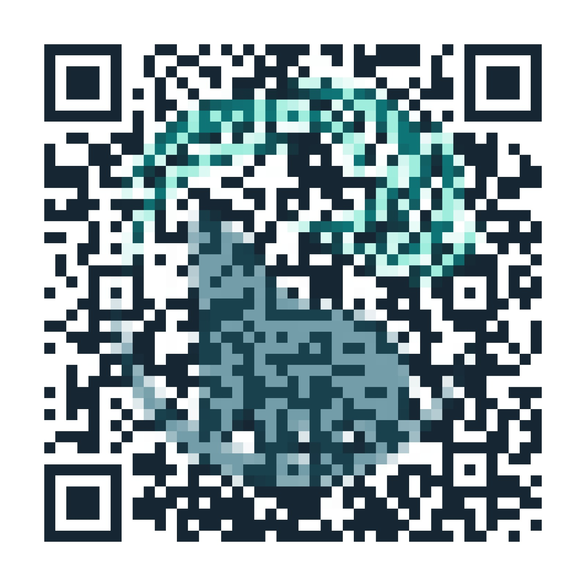

# PolarLabs QR Studio

**QR artistici in stile pixel art, generati localmente da un logo PNG/SVG e da un URL.**



**Gratis • Open source • Windows ARM64 • Nessun account • Nessun caricamento di loghi online**

PolarLabs QR Studio trasforma i colori e la silhouette di un logo in un mosaico di **veri moduli QR**. Nella modalità principale *Mosaico fedele*, l'immagine non viene incollata sopra al codice: il risultato resta un QR con moduli scuri/chiari, colorati in base al logo. Il motore cerca una griglia più dettagliata e verifica automaticamente il contenuto decodificato.

## Download e avvio

**[Scarica codice sorgente v1.0.0](downloads/PolarLabs-QR-Studio-v1.0.0-source.zip)**. Le impronte SHA-256 degli archivi sono in [SHA256SUMS.txt](SHA256SUMS.txt).

**[Scarica PolarLabs QR Studio v1.0.0 per Windows ARM64](downloads/PolarLabs-QR-Studio-v1.0.0-Windows-ARM64.zip)**, estrai lo ZIP e avvia `PolarLabs-QR-Studio.exe`. Per il codice sorgente usa **Code > Download ZIP** oppure git clone.

> **Compatibilità:** il programma precompilato è destinato a Windows 11 **ARM64** (per esempio alcuni Microsoft Surface). Non è una build Windows x64. L'eseguibile non è firmato digitalmente: Windows SmartScreen, Smart App Control o criteri aziendali possono bloccarlo. **Non disattivare le protezioni di Windows per eseguirlo**; in quel caso avvia il codice sorgente come indicato sotto.

### Avvio da sorgente

Occorrono Python 3.13 e pip. È consigliato un ambiente virtuale:

```powershell
git clone https://github.com/PolarLabs-OSS/polarlabs-qr-studio.git
cd polarlabs-qr-studio
python -m venv .venv
.\.venv\Scripts\python.exe -m pip install -r requirements.txt
.\.venv\Scripts\pythonw.exe studio.py
```

Se le policy PowerShell impediscono l'attivazione dell'ambiente, i comandi con `.venv\Scripts\python.exe` funzionano senza lanciare script di attivazione.

### Utilizzo

1. Seleziona il **logo PNG o SVG**, preferibilmente con trasparenza.
2. Inserisci l'**URL completo** (`https://...`).
3. Scegli **Mosaico fedele** e regola la **Fedeltà al logo** (100% per la massima resa).
4. Premi **Genera e verifica QR**.
5. Esporta in **PNG** (1590 × 1590 px) o **SVG** (moduli vettoriali).

Sono presenti inoltre le modalità *Mosaico soft*, *Colori originali* e *Monocromatico*.

## Come funziona

- QR con livello di correzione errori **H**.
- Pattern funzionali, tre marcatori angolari e quiet zone protetti.
- Il logo colora i **moduli veri** del codice: nessun logo sovrapposto.
- Matrice più fitta quando utile per dettaglio visivo (motore mosaico).
- Decodifica di controllo tramite **ZXing-C++** a 800, 450 e 280 px.
- Se la resa non supera i test, il motore cerca una combinazione più conservativa.

**Limite importante:** un QR codifica dati precisi; non è possibile riprodurre perfettamente ogni singolo pixel di qualsiasi logo e garantire contemporaneamente la lettura. I test automatici **non sostituiscono** una prova con smartphone, carta e supporto di stampa reali.

## Privacy

Tutte le elaborazioni avvengono sul dispositivo. Il programma non richiede credenziali né API, e non invia logo o URL a servizi esterni.

## Ricompilare l'eseguibile ARM64

Su Windows ARM64 con Python ARM64:

```powershell
.\build-windows-arm64.ps1
```

In alternativa esegui PyInstaller con `--onefile --windowed`, icona e assets. Lo script include tutte le librerie richieste; non produce una firma digitale.

## Test

```powershell
python -m unittest discover -s tests -v
```

Verifica che vari QR esportati siano decodificati sull'immagine e sull'SVG renderizzato. I test sono eseguibili senza rete.

## Progetto

- `studio.py`: interfaccia desktop responsive.
- `qr_engine.py`: generazione QR, gestione PNG/SVG e verifica decodifica.
- `pixel_mosaic.py`: modalità Mosaico fedele.
- `assets/`: logo demo e screenshot dimostrativo.
- `build-windows-arm64.ps1`: script di build.

Software sviluppato da **PolarLabs**, brand di **Space Services SRLS**.

© 2026 Space Services SRLS / PolarLabs. Codice distribuito con licenza **MIT**. Il nome e i marchi PolarLabs rimangono segni distintivi dei rispettivi titolari; la licenza software non concede diritti di marchio.

